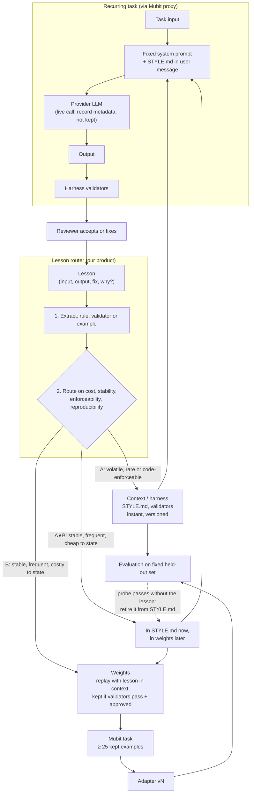

# Product architecture: the lesson router

- **Purpose:** Fix the shape of our product and the evidence the demo and deck must show.
- **Author:** Claude (Claude Code) with the team · **Date:** 2026-10-24
- **Status:** Agreed direction from the whiteboard session, revised after review on 2026-10-24. Primary track: **2, Own your intelligence layer**. Leading use case: on-style SVG icon generation, see [USE_CASE.md](USE_CASE.md).
- **Basis:** [HACKATHON.md](HACKATHON.md) (Mubit behaviour and staff Q&A), [PRODUCT_CRITERIA.md](PRODUCT_CRITERIA.md) and [research/weight-updates-vs-context.gpt.md](research/weight-updates-vs-context.gpt.md).

## Pitch

A company generating outputs in a house style keeps learning lessons from its reviewers. The router decides, lesson by lesson, which ones it **rents** in every prompt and which ones it **owns** in its model's weights. Lessons take effect in context immediately; Mubit trains the weights; we measure quality, cost and latency of every configuration.

## Input

A **lesson** comes from one of three sources (whiteboard):

1. **Correction event** (primary): `(task input, model output, human-fixed output, optional "why")`. This is what judges score: "a correction becomes a model update in the demo".
2. **Measurement**: a validator failure or an evaluation drop. Stretch goal.
3. **New time-series data**: drift in what the task is asked to do. Stretch goal.

## The constraint that shapes the design

Mubit trains only on provider answers it keeps; there is no corrections API ([HACKATHON.md](HACKATHON.md)). To teach the weights anything, context must first make the provider produce the right answer. So route B always passes through context: the router does not decide *whether* context is used, it decides **where a lesson lives long-term** and therefore what every future call pays for.

## Diagram

## Routing rules

The router decides from signals it can compute, not from an open-ended judgement.

| Signal | How it is computed |
| --- | --- |
| Context cost | Tokens needed to state or show the lesson × calls per day |
| Stability | Is the lesson expected to change (a brand colour this quarter) or not (a stroke width)? Set by the reviewer, defaulting to stable |
| Enforceability | Can a validator or post-processor in the harness check or apply it? |
| Reproducibility | Does the provider produce the fix when given the lesson in context, without seeing the fixed output? If not, Mubit has nothing correct to learn from |

| Route | When | Where it lives |
| --- | --- | --- |
| **A** | Volatile, rare, or enforceable by code | STYLE.md and harness validators, permanently |
| **B** | Stable, frequent, costly to state (often only showable by example) and reproducible | Weights; in context only during training replays |
| **A∧B** | Stable, frequent, cheap to state and reproducible | STYLE.md until the adapter passes the lesson's probe set without it, then retired |

A lesson that is not reproducible stays in A until it is rewritten as one that is.

## Recording rules

1. **The system prompt never changes.** STYLE.md goes in the user message; otherwise every lesson starts a new Mubit task with zero examples.
2. **Only an approved context is recorded in full.** Whether a call is recorded is fixed at request time, and a Bad rating does not remove a call from training, so an individual output cannot be approved before it is kept. Previews, evaluation calls and calls under an unapproved context therefore go out with `x-middleware-record: metadata`. Once the reviewer approves a context (STYLE.md plus examples) on a preview batch, training calls under that context are recorded in full. Validators measure the quality of what was kept.
3. **A training call never sees its own answer.** A fixed output may serve as an example for other inputs, but not in a training call for its own input; otherwise the adapter learns to copy.

Replays are not deterministic: on 2026-10-24 two identical calls to `claude-sonnet-5-5` returned different SVGs, and the current Anthropic API takes no `temperature`. So a replay cannot be relied on to reproduce an approved output, which is why approval applies to the context rather than to each output.

## Platform constraints the design respects

| Constraint (source: [HACKATHON.md](HACKATHON.md)) | Design response |
| --- | --- |
| No corrections API; a Bad rating does not remove a call from training | Recording rules 2 and 3: only approved replays are kept |
| Task identity includes the system prompt | Recording rule 1 |
| Adapter trains at ~25 kept examples; training stalls reported | B is shown with a pre-trained, timestamped adapter version; A is shown live |
| Adapters cannot be called by model ID, only in Try models | Adapter rows are scored manually in Try models, so the held-out set stays at 20–25 cases; adapter latency is labelled as not comparable with API latency |
| Mubit's promotion test measures agreement with the provider | We run our own evaluation; Mubit's "Passed" cannot show the adapter beats the provider |
| Pricing is per run of ≤ 8K tokens | Context cost is reported in runs as well as tokens: a prompt that crosses 8K tokens costs an extra run |

## Evaluation

All configurations run on one fixed held-out set that was never corrected, held out by session.

| Configuration | Question it answers |
| --- | --- |
| Frontier, no context | What does the user get today? |
| Frontier + full STYLE.md (A only) | What does context alone achieve? Fair baseline: same lessons, same budget |
| Adapter, no context (B only) | What did the weights absorb? |
| Adapter + routed STYLE.md (A∧B) | The router's configuration |
| Previous configuration | Did the latest lessons improve on the last version? |

Metrics: validator pass rate, semantic quality (blind human ranking or a judge routed through Mubit), prompt tokens per call, cost per 1,000 outputs, latency. Report counts (n/N), not percentages alone.

## Evidence we aim to obtain

In priority order.

| # | Evidence | Shape in deck | What it proves |
| --- | --- | --- | --- |
| 1 | Track 2 table: quality, tokens, cost per 1,000 and latency for each configuration | Table | Owning lessons in weights keeps quality at lower cost |
| 2 | Transfer: corrected lessons hold on fresh inputs | Before/after bars | Corrections stick beyond the corrected case |
| 3 | Router ablation: everything to A vs everything to B vs routed | Grouped bars | The router earns its place: all-A bloats the prompt; all-B is slow and loses volatile lessons |
| 4 | STYLE.md size over time: grows with lessons, shrinks as lessons retire | Line chart | Weights absorb what context held |
| 5 | Time to effect: A in seconds, B in hours | Timeline with timestamps | Honest about the two speeds |

## Open questions and first tests

- **Can a Mubit adapter produce valid, on-style output for the chosen use case?** Biggest risk; test in Try models on 20 held-out cases. See [USE_CASE.md](USE_CASE.md).
- **Does the adapter keep a lesson once it is removed from context?** Mubit trains on the full request, including STYLE.md. If the adapter only learns "STYLE.md present → behaviour", retirement (evidence 4) fails; evidence 1–3 still stand. Test by training on replays with the lesson and comparing in Try models with and without it.
- **Which base model and context window does the adapter use?** Not documented.
- **Router implementation:** rules over the computed signals, plus one extraction call through Mubit under its own fixed system prompt, recorded as metadata only.
