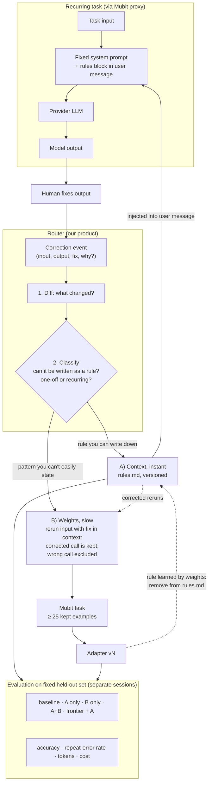

# Product architecture: the correction router

- **Purpose:** Fix the shape of our product and the evidence the demo and deck must show, before choosing a use case.
- **Author:** Claude (Claude Code) with the team · **Date:** 2026-10-24
- **Status:** Agreed direction from the whiteboard session. Use case not yet chosen; assess candidates with [PRODUCT_CRITERIA.md](PRODUCT_CRITERIA.md).
- **Basis:** [HACKATHON.md](HACKATHON.md) (Mubit behaviour and staff Q&A) and [research/weight-updates-vs-context.gpt.md](research/weight-updates-vs-context.gpt.md).

## Pitch

Every correction is sorted: rules you can write down update the context immediately, and patterns you can't become training data so Mubit updates the model. We build the router and the evaluation; Mubit does the training.

## Input

A **correction event** on a recurring task: `(task input, model output, human-fixed output, optional "why")`.

- It is what judges score: "a correction becomes a model update in the demo".
- The diff between output and fix is what the router classifies.
- Measurements (eval drops) and new time-series data are **triggers** for when to look, not inputs. Stretch goals only.

## Diagram

The dotted loop is the core story: **A is the short-term fix and B is the long-term one.** The context grows after corrections, then shrinks as the adapter learns the same behaviour.

## Platform constraints the design respects

| Constraint (source: [HACKATHON.md](HACKATHON.md)) | Design response |
| --- | --- |
| No corrections API; a Bad rating does not remove a call from training | B is fed by controlling which calls are **kept**: rerun with the fix in context so the kept provider answer is correct; send the wrong call with `x-middleware-record: metadata` |
| Task identity includes the system prompt | System prompt stays fixed; A's rules go in the user message, or every rule change starts a new task with zero examples |
| Adapter trains at ~25 kept examples; training stalls reported | B is shown with a pre-trained, timestamped adapter version; A is shown live |
| Adapters cannot be called by model ID, only in Try models | B and A+B rows are scored manually in Try models, so the held-out set stays small (20–30 cases) |
| Mubit's promotion test measures agreement with the provider | We run our own evaluation; Mubit's "Passed" cannot show A+B beats the provider |

## Evidence we aim to obtain

In priority order. All on one fixed held-out set that was never corrected (otherwise we measure memorisation), held out by session.

| # | Evidence | Shape in deck | What it proves |
| --- | --- | --- | --- |
| 1 | Headline table: accuracy, prompt tokens per call, cost per 1K tasks for baseline, A only, A+B, frontier + A | Table | The loop improves the task |
| 2 | Repeat-error rate: after a correction, does the same kind of mistake recur on new inputs? | Before/after bars | Corrections actually stick (the judged claim) |
| 3 | Router ablation: everything to A vs everything to B vs routed | Grouped bars | The router earns its place: all-A bloats the prompt and plateaus; all-B is slow and needs ~25 examples |
| 4 | Time to effect: A in seconds, B in hours | Timeline with timestamps | Honest about the two speeds |
| 5 | Context size over time: `rules.md` grows with corrections, shrinks as B learns | Line chart | Weights absorb what context held |

## Open questions

- Which use case produces corrections that are a clear mix of writable rules and tacit patterns? Without both, the router has nothing to decide.
- Does Mubit train on the full request, including the rules block? If so, the adapter learns "rules present → behaviour", not the behaviour alone; removing rules after B may regress. Test before claiming row 5.
- How the router classifies: LLM judge (routed via Mubit), heuristics on the diff, or both.
